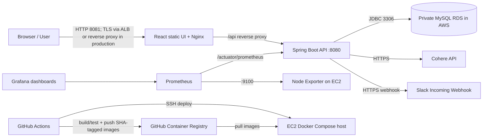

# Architecture



## Trust boundaries

- The browser reaches only the frontend entry point; Nginx proxies `/api` internally to Spring Boot.
- The backend reaches MySQL on a private RDS endpoint. RDS security group ingress should reference the EC2 security group only.
- Cohere and Slack credentials are injected at runtime and must not be committed.
- Prometheus and Grafana ports are loopback-bound in the sample Compose file; use a private tunnel/VPN or authenticated proxy for administration.
- GitHub Actions publishes immutable commit-SHA image tags. The EC2 host pulls those tags during deployment.
```
